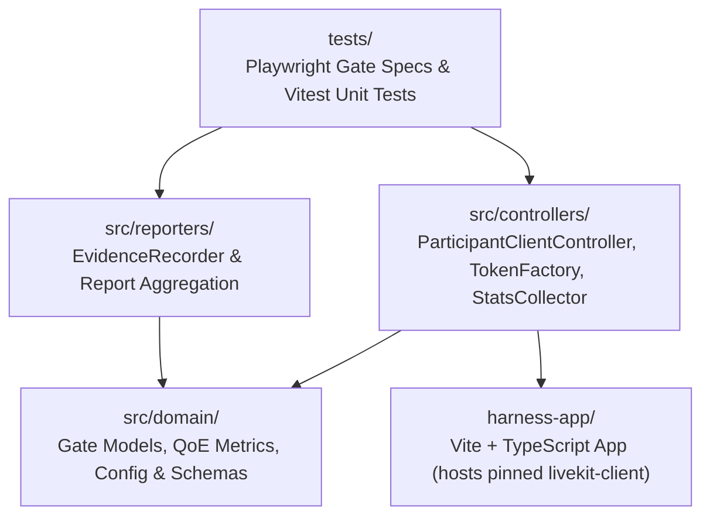

# RTC Compatibility Suite (`rtc-compatibility-suite`)

[](https://nodejs.org/)
[](https://playwright.dev/)
[](https://www.typescriptlang.org/)
[-orange.svg)](https://www.npmjs.com/package/livekit-client)

Strict, black-box End-to-End (E2E) WebRTC compatibility and verification suite for **EkbatanRoom** media services (`signaling-coordinator` in Go and `sfu-media-node` in Rust / Mediasoup).

---

## 1. Overview & Engineering Principles

This suite validates whether the official, unmodified [`livekit-client`](https://www.npmjs.com/package/livekit-client) SDK can seamlessly connect, negotiate, stream bidirectional audio/video, handle concurrent renegotiations, manage simulcast layer switches, and recover from network interruptions against the EkbatanRoom backend.

### Core Tenets

1. **Strict Black-Box Verification:**
   - The official `livekit-client` package is strictly pinned to version **`2.23.0`** (without `^` or `~`).
   - **Zero SDK patching:** No monkey-patching, no mock WebSocket transports, and no client-side protocol overrides.
   - Tests execute inside real headless Chromium browser contexts using real WebRTC peer connections.

2. **No False Positives (Real Media Verification):**
   - Mere WebSocket connectivity or `room.state === 'connected'` is **insufficient** to pass media gates.
   - Media gates require empirical WebRTC proof via `RTCPeerConnection.getStats()`:
     - Positive delta in RTP throughput (`bytesSent > 0`, `bytesReceived > 0`).
     - Demonstrable video frame progression rendered into HTML `<video>` elements (`videoWidth > 0`, `videoHeight > 0`).

3. **Sequential Dependency Gating:**
   - Gates execute in strict serial order (`00` through `05`).
   - If an upstream gate fails (e.g., Gate 1 Connection), all downstream dependent gates are immediately marked as **`BLOCKED`** and skipped to avoid misleading root-cause failures.

4. **Structured Evidence Artifacts:**
   - Every run generates a comprehensive, machine-readable JSON artifact at [`test-results/evidence-report.json`](test-results/evidence-report.json).
   - Captures SDK version, Chromium version, redacted signaling frames, ICE/DTLS connection states, and QoE/RTP metric snapshots.

5. **Twelve-Factor & Hot-Path Observability:**
   - 100% configurable via `OBS_*` environment variables.
   - Low metric cardinality: High-cardinality IDs (`room_id`, `peer_id`, `transport_id`) are never exported as Prometheus/Metrics labels.
   - Strict security redaction: Raw JWT tokens, ICE passwords, and unencrypted SDPs are never persisted in traces unless explicitly enabled.

---

## 2. Five-Layer Clean Test Architecture

The repository adheres to a strict 5-layer Clean Test Architecture with explicit separation of concerns and Dependency Inversion:



- **`harness-app/`**: Lightweight browser application built with Vite and TypeScript. Imports the official `livekit-client` library, manages DOM video/audio elements, and exposes the `window.testHarness` control API.
- **`src/domain/`**: Framework-agnostic models, gate lifecycle definitions (`GateStatus`: `PASSED`, `FAILED`, `BLOCKED`, `NOT_RUN`), QoE metric schemas, and configuration loaders.
- **`src/controllers/`**: Browser automation and orchestration:
  - `ParticipantClientController`: Encapsulates Playwright page interactions, track publishing, video quality switching, and ICE restarts.
  - `TokenFactory`: Generates deterministic HS256-signed test JWTs.
  - `StatsCollector`: Normalizes and extracts standard W3C WebRTC statistics (`RTCPeerConnection.getStats()`).
  - `GateExecutionRegistry`: Thread-safe and cross-worker gate state coordination with disk persistence.
- **`src/reporters/`**: Collects execution evidence, redacts credentials, and writes structured reports.
- **`tests/`**: Specification files for each compatibility gate.

---

## 3. Verification Gates

| Gate | Specification | Key Verification Objectives |
| :--- | :--- | :--- |
| **Foundation** | [`tests/00-harness-foundation.spec.ts`](tests/00-harness-foundation.spec.ts) | Verifies `harness-app` DOM elements, `window.testHarness` initialization, and ensures downstream gates default to `NOT_RUN`. |
| **Gate 1** | [`tests/01-connection.spec.ts`](tests/01-connection.spec.ts) | Establishes WebSocket connection to `/rtc`, completes LiveKit protocol v12 `JoinResponse` exchange, and verifies participant enters `CONNECTED` state. |
| **Gate 2** | [`tests/02-bidirectional-rtp.spec.ts`](tests/02-bidirectional-rtp.spec.ts) | Connects two independent browser participants (Alice & Bob). Proves bidirectional audio/video transfer via positive `bytesSent` and `bytesReceived` deltas and non-zero `<video>` rendering dimensions. |
| **Gate 3** | [`tests/03-concurrency-glare.spec.ts`](tests/03-concurrency-glare.spec.ts) | Simulates concurrent publish/subscribe operations, parallel negotiation glare (Offer/Answer collisions), and participant churn (Charlie joins and leaves abruptly) while verifying state convergence. |
| **Gate 4** | [`tests/04-simulcast-layers.spec.ts`](tests/04-simulcast-layers.spec.ts) | Evaluates two distinct checks:<br>• **Check A (SFU Layer Selection):** Verifies media flow continuity across spatial layer switches (`low` vs `high`).<br>• **Check B (LiveKit Protocol Mapping):** Verifies that `setVideoQuality('low')` emits an outbound protobuf `UpdateTrackSettings` frame over the signaling WebSocket. |
| **Gate 5** | [`tests/05-ice-restart.spec.ts`](tests/05-ice-restart.spec.ts) | Triggers a real ICE restart via the official SDK (`engine.pcManager.triggerIceRestart()`), verifies signaling renegotiation, and confirms positive post-restart media resumption deltas. |

---

## 4. Prerequisites

- **Node.js:** `>= 20.0.0`
- **npm:** `>= 10.0.0`
- **Docker & Docker Compose:** (if running backend services via containers)
- **Local Toolchains (optional, for running backends directly):**
  - **Go:** `>= 1.22` (for `signaling-coordinator`)
  - **Rust / Cargo:** `>= 1.80` (for `sfu-media-node`)

---

## 5. Setup & Installation

1. **Clone and navigate to the suite directory:**
   ```bash
   cd rtc-compatibility-suite
   ```

2. **Install dependencies:**
   ```bash
   npm ci
   ```

3. **Install Playwright Chromium browser:**
   ```bash
   npx playwright install chromium
   ```

---

## 6. Starting Backend Services

The compatibility suite requires `sfu-media-node` and `signaling-coordinator` running before executing E2E tests.

### Option A: Using Docker Compose

From the `rtc-compatibility-suite` directory:

```bash
docker compose up -d
```

### Option B: Running Local Binaries

In Terminal 1 (SFU Media Node):
```bash
cd ../sfu-media-node
cargo build
MEDIASOUP_LISTEN_IP=0.0.0.0 \
MEDIASOUP_ANNOUNCED_IP=127.0.0.1 \
RTC_MIN_PORT=40000 \
RTC_MAX_PORT=49999 \
GRPC_PORT=50051 \
OBS_LOG_LEVEL=info \
OBS_LOG_FORMAT=json \
OBS_METRICS_ENABLED=true \
OBS_METRICS_ADDR=0.0.0.0:9090 \
./target/debug/sfu-media-node
```

In Terminal 2 (Signaling Coordinator):
```bash
cd ../signaling-coordinator
go build -o bin/coordinator ./cmd/coordinator
PORT=7880 \
SFU_GRPC_ADDR=127.0.0.1:50051 \
OBS_LOG_LEVEL=info \
OBS_LOG_FORMAT=json \
OBS_METRICS_ENABLED=true \
./bin/coordinator
```

---

## 7. Running Tests

### 1. Static Type Checking
Validates both the suite infrastructure and the harness application:
```bash
npm run typecheck
```

### 2. Unit Tests
Runs unit tests for token generation, stats collection, sequential gating logic, and credential redaction:
```bash
npm run test:unit
```

### 3. Full Compatibility Gate Suite
Executes all gates sequentially against running backend services:
```bash
npm run test:gates
# or
npx playwright test
```

### 4. Running a Specific Gate
```bash
# Run Gate 1 only
npx playwright test tests/01-connection.spec.ts

# Run Gates 1 & 2
npx playwright test tests/01-connection.spec.ts tests/02-bidirectional-rtp.spec.ts
```

### 5. Building the Harness for Production
```bash
npm run harness:build
```

---

## 8. Configuration Reference

The suite can be customized via environment variables:

| Variable | Default Value | Description |
| :--- | :--- | :--- |
| `SIGNALING_URL` | `ws://127.0.0.1:7880` | WebSocket endpoint for the signaling coordinator. |
| `SFU_GRPC_ADDR` | `127.0.0.1:50051` | gRPC address of `sfu-media-node`. |
| `HARNESS_URL` | `http://localhost:5173` | Base URL of the browser harness web app. |
| `EVIDENCE_REPORT_PATH`| `test-results/evidence-report.json` | Destination path for the evidence artifact. |
| `OBS_LOG_LEVEL` | `info` | Logging verbosity (`trace`, `debug`, `info`, `warn`, `error`). |
| `OBS_LOG_FORMAT` | `json` | Log output format (`json` or `pretty`). |
| `OBS_LOG_RAW_SDP` | `false` | When `true` and log level is `debug`, preserves raw SDP in traces. |
| `OBS_METRICS_ENABLED` | `true` | Enables RTP metrics collection and snapshots. |
| `OBS_CAPTURE_BROWSER_LOGS` | `false` | When `true`, records browser console logs into evidence. |
| `OBS_TRACING_ENABLED` | `false` | Enables W3C Trace Context propagation. |

---

## 9. Evidence Report Structure

After each run, [`test-results/evidence-report.json`](test-results/evidence-report.json) provides structured verification evidence:

```json
{
  "suiteVersion": "1.0.0",
  "sdkVersion": "2.23.0",
  "runId": "run-1793519074994",
  "timestamp": "2026-11-01T07:44:34.994Z",
  "browser": {
    "name": "chromium",
    "version": "131.0.6778.33"
  },
  "overallStatus": "PASSED",
  "summary": {
    "passed": 5,
    "failed": 0,
    "blocked": 0,
    "notRun": 0,
    "total": 5
  },
  "gates": {
    "gate_01_connection": { "status": "PASSED", "durationMs": 486, ... },
    "gate_02_bidirectional_rtp": { "status": "PASSED", "durationMs": 7566, ... },
    "gate_03_concurrency_glare": { "status": "PASSED", "durationMs": 4349, ... },
    "gate_04_simulcast_layers": { "status": "PASSED", "durationMs": 7357, ... },
    "gate_05_ice_restart": { "status": "PASSED", "durationMs": 5182, ... }
  }
}
```

---

## 10. Repository Guidelines & Code Boundaries

- **Strict Repository Boundaries:** Test code must never mutate or depend on internals of sibling repositories (`signaling-coordinator` or `sfu-media-node`).
- **No SDK Modification:** Never patch files inside `node_modules/livekit-client`.
- **Media Proof:** Every new test or assertion must verify actual media delivery via `getStats()` or `<video>` dimensions rather than synthetic state assertions.
